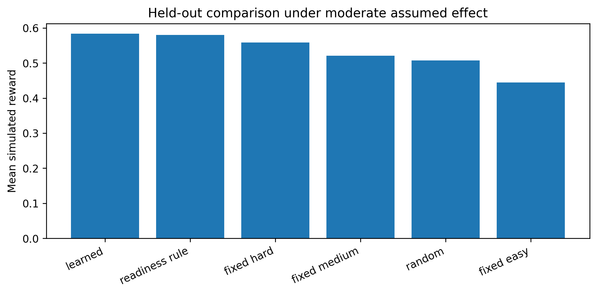

# SHIVA-LLM Objective 02

**Reproducible simulation-based, one-step contextual-bandit policy optimisation using HyperKT readiness predictions** — with authenticated event alignment, reward redesign, comparative evaluation, ablation studies, robustness analysis and a publication package.

> **Scope statement.** All policy results here are differences in a specified **simulated utility**. They do **not** establish causal instructional effects, long-term mastery gains or sequential reinforcement-learning performance. See [docs/limitations.md](docs/limitations.md).

## At a glance
| | |
|---|---|
| Dataset | ASSISTments 2009 Skill Builder (corrected, collapsed) — 346,860 raw rows, 4,163 students, 149 skills ([data/](data/)) |
| Readiness signal | Frozen HyperKT (Objective 01) pre-response correctness probability |
| Partitions | HyperKT learner-disjoint 80/10/10: 222,562 / 23,858 / 32,522 events; 3,222 / 403 / 402 learners |
| Actions | Easy / medium / hard item difficulty (assumed effects; d = 0, 0.15, 0.40, 0.80 log-odds) |
| Reward | Balanced utility: correctness 0.30, challenge 0.40, suitability 0.25, cost 0.05 (τ = 0.70, h = 0.20) |
| Policy | Depth-2 decision tree, trained on train, selected on validation, frozen before test |
| Statistics | Paired learner-cluster bootstrap (500 reps), 30-seed random baseline, ablations, perturbations |
| Reproducibility | Stage 5 → 6 → 7 replication error 5.55 × 10⁻¹⁷; SHA-256 provenance manifest |

## Headline result (locked test, moderate assumed effect)
| Policy | Mean simulated reward |
|---|---|
| **Learned decision tree** | **0.583721** |
| Readiness rule (p < 0.4 easy, < 0.7 medium, else hard) | 0.579755 |
| Fixed hard | 0.558514 |
| Fixed medium | 0.520812 |
| Random | 0.507227 |
| Fixed easy | 0.444207 |

The learned policy minus the readiness rule is **+0.003965** (95% CI 0.003547–0.004403). Minus the best fixed action it is **+0.025207** (95% CI 0.022672–0.028005).

The advantage over the best fixed action is **negative under zero and small assumed effects**, and it reverses when the suitability term is removed. Full details are in [docs/results_summary.md](docs/results_summary.md).



## Pipeline
Each stage folder contains the Colab notebook, all of its outputs, and a README explaining purpose, inputs, method, results and files.

| Stage | Folder | What it does |
|---|---|---|
| 1 | [stage01_starter_baseline](stages/stage01_starter_baseline) | First logged-action transitions and behaviour-cloning baseline (later superseded) |
| 1A | [stage01a_hyperkt_data_preparation](stages/stage01a_hyperkt_data_preparation) | HyperKT student-disjoint split, skill vocabulary, co-occurrence |
| 1B | [stage01b_hyperkt_sequence_construction](stages/stage01b_hyperkt_sequence_construction) | HyperKT 200-step target sequences |
| 2 | [stage02_hyperkt_state_export](stages/stage02_hyperkt_state_export) | Export frozen HyperKT pre-response predictions |
| 2B | [stage02b_event_alignment_audit](stages/stage02b_event_alignment_audit) | Detect split conflicts; refuse unauthenticated joins |
| 2C | [stage02c_event_crosswalk](stages/stage02c_event_crosswalk) | Verified event crosswalk to original `user_id`/`order_id` |
| 3 | [stage03_reward_and_transitions](stages/stage03_reward_and_transitions) | Reward proxies and observed transitions |
| 3B | [stage03b_action_transition_audit](stages/stage03b_action_transition_audit) | Show logged actions are not interventions → move to a simulator |
| 4A | [stage04a_simulator](stages/stage04a_simulator) | Calibrated response model + assumption-based simulator |
| 4A-B | [stage04ab_robustness_audit](stages/stage04ab_robustness_audit) | Calibration audit; finds fixed-easy dominance |
| 4A-C | [stage04ac_reward_redesign](stages/stage04ac_reward_redesign) | Balanced challenge/suitability reward (validation-selected) |
| 4B | [stage04b_policy_optimization](stages/stage04b_policy_optimization) | Train and select the depth-2 tree policy |
| 5 | [stage05_comparative_evaluation](stages/stage05_comparative_evaluation) | Paired bootstrap comparison, robustness |
| 6 | [stage06_ablation_analysis](stages/stage06_ablation_analysis) | Reward ablations, readiness perturbations, calibration |
| 7 | [stage07_publication_package](stages/stage07_publication_package) | Tables (CSV/LaTeX), figures (PNG/PDF), audit, manifest |

## Repository layout
```text
data/                     ASSISTments 2009 source CSV (gzip) + data notes
stages/<stage>/           notebook(s), README, outputs/ (CSV, JSON, joblib, PNG/PDF)
stages/<stage>/superseded earlier notebook versions kept for provenance
scripts/make_stage_zips.py  rebuild the stage ZIPs the notebooks expect as uploads
docs/                     methodology, results summary, figures, reproduction, limitations, checksums
```
Files over 20 MB are stored gzip-compressed (`*.csv.gz`). pandas reads them directly, and `make_stage_zips.py` restores the original names.

## Documentation
- [Methodology](docs/methodology.md)
- [Results summary](docs/results_summary.md)
- [Figures gallery](docs/figures.md)
- [Reproduction guide](docs/reproduction.md)
- [Limitations](docs/limitations.md)

## Related work
Part of a multi-objective research thesis. The readiness signal comes from the HyperKT knowledge-tracing model of Objective 01: [HyperKT-Knowledge-Tracing](https://github.com/dharavathshivanayak201-debug/HyperKT-Knowledge-Tracing).

## Citation
Citation details will be added once the Objective 02 manuscript is available. If you use the dataset, cite ASSISTments as described in [data/README.md](data/README.md).
