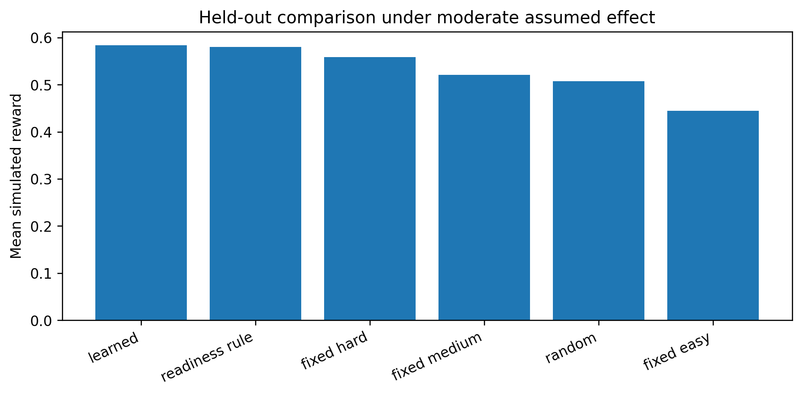
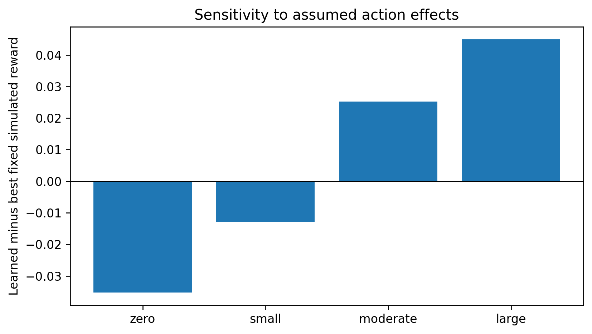
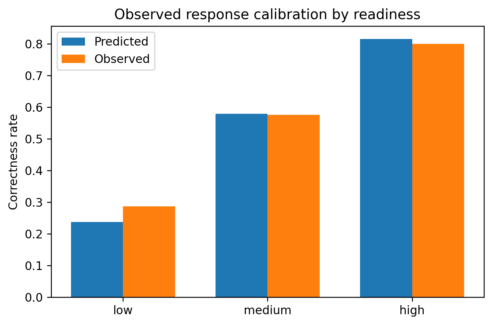
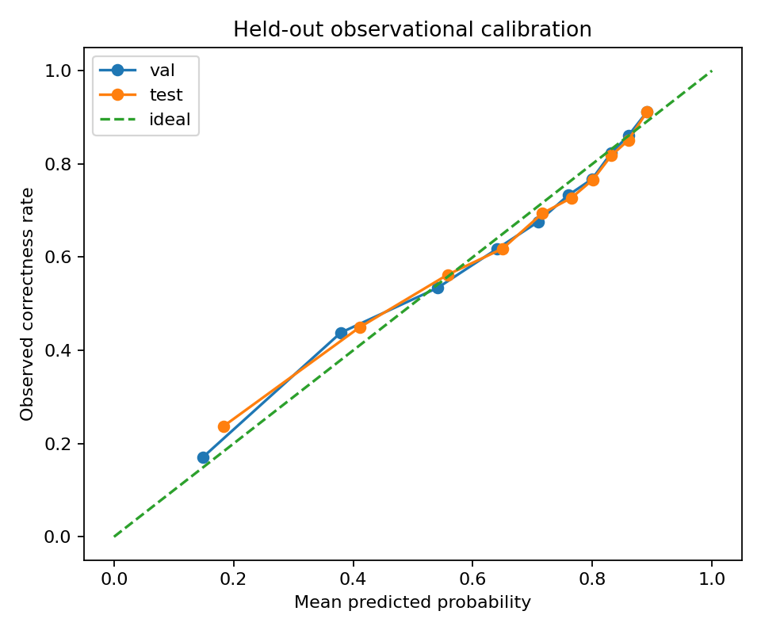
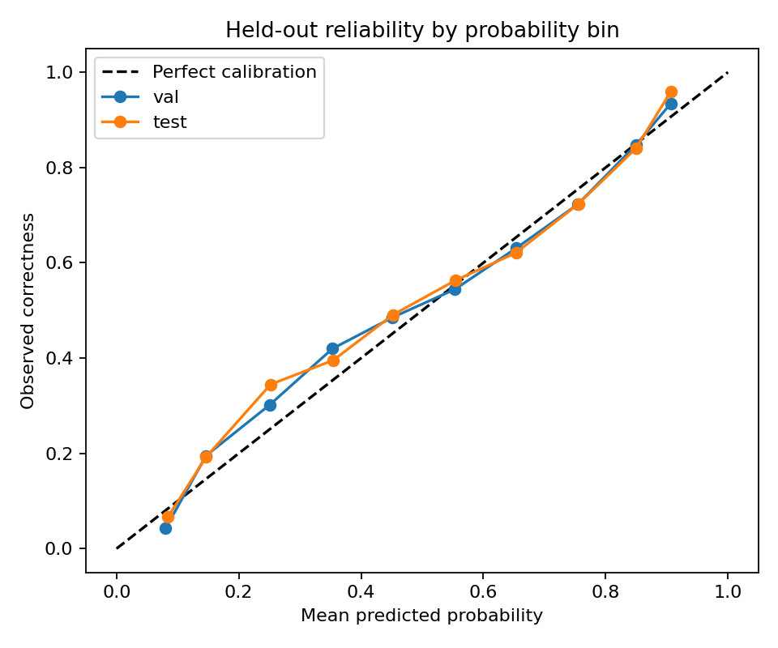
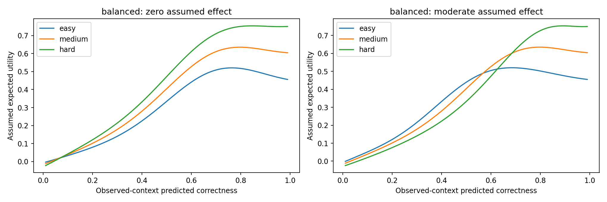
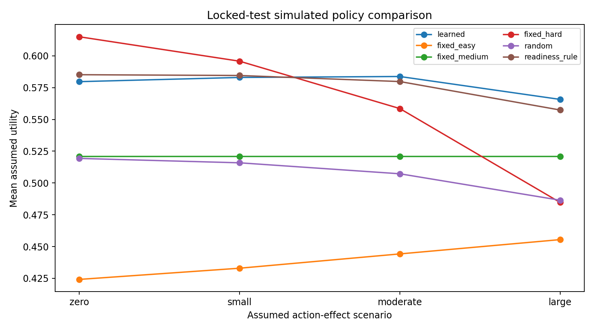
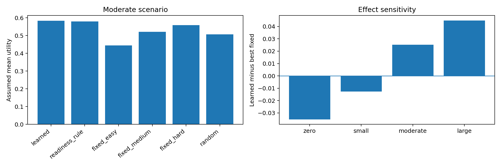
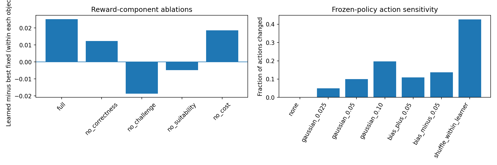

# Figures

## Publication figures (Stage 7)
**Figure 1 — Simulated policy rewards, moderate assumed effect.** Mean simulated utility per policy on the locked test split. Vector PDF: `figure_01_policy_rewards.pdf`.

**Figure 2 — Sensitivity to the assumed action effect.** Policy rewards across the zero, small, moderate and large effect scenarios.

**Figure 3 — Observed response calibration by readiness.** Predicted versus observed correctness in the low, medium and high readiness groups. The low group is under-predicted by about 5 points.

## Stage figures
**Stage 4A — Response-model calibration.**

**Stage 4A-B — Held-out reliability diagram.**

**Stage 4A-C — Utility curves under the balanced reward.** With zero assumed effect (left), hard dominates. With moderate effect (right), the curves cross, so the optimal action depends on readiness.

**Stage 4B — Test policy rewards across scenarios.**

**Stage 5 — Policy comparison and effect sensitivity.** Left: moderate-scenario utility by policy. Right: learned minus best fixed action per scenario.

**Stage 6 — Reward ablations and readiness perturbations.** Left: learned minus best fixed action within each ablated objective. Right: fraction of actions changed under each perturbation.

