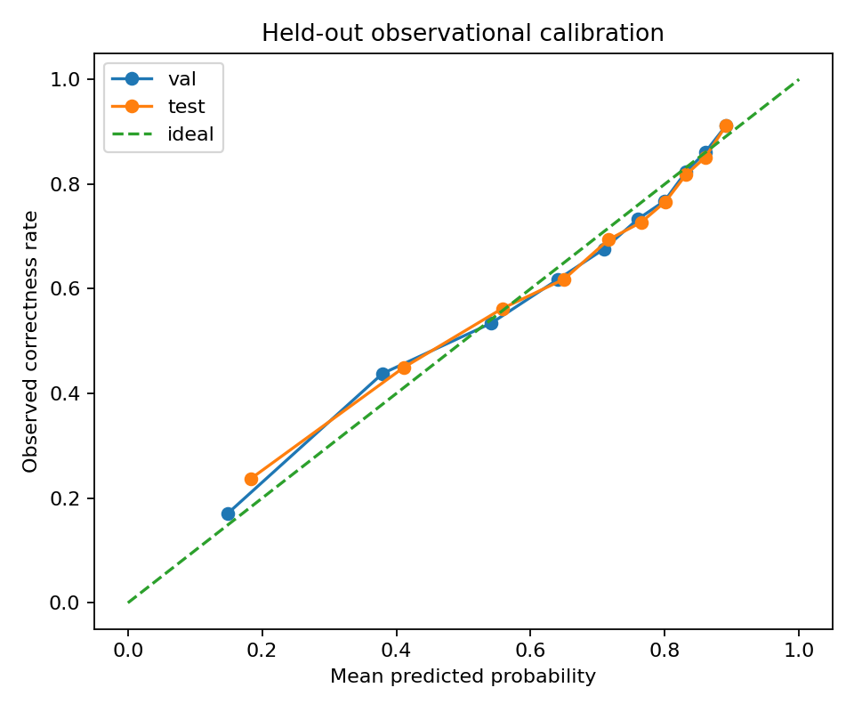

# Stage 4A — HyperKT-guided response model and assumption-based simulator

**Notebook:** `SHIVA_LLM_Objective02_Stage4A_Simulator_Colab.ipynb` · **Runtime:** Colab CPU, 12–16 GB RAM · **Inputs:** Stage 3 and Stage 3B ZIPs · **Output archive:** `objective02_stage4a_simulator.zip`

## Purpose
Builds the one-step contextual-bandit environment used by every later stage. It has two parts:
1. an **empirical** response model, calibrated on observed correctness, and
2. an **assumed** action-response rule for easy / medium / hard items.

## 1. Response model (empirical)
- Features: `hyperkt_pred_correct`, `prior_accuracy`, `prior_attempts` (all pre-response).
- Model: `StandardScaler → LogisticRegression`, **fitted on training learners only**; HyperKT partitions preserved.
- Output `p_observed` = predicted probability of a correct response for each event.

| Split | n | Learners | Brier | Log loss | AUC | Accuracy | Observed rate | Predicted rate |
|---|---|---|---|---|---|---|---|---|
| Train | 222,562 | 3,222 | 0.1755 | 0.5276 | 0.7711 | 0.7428 | 0.6599 | 0.6599 |
| Validation | 23,858 | 403 | 0.1807 | 0.5398 | 0.7588 | 0.7324 | 0.6532 | 0.6561 |
| Test | 32,522 | 402 | 0.1852 | 0.5509 | 0.7420 | 0.7258 | 0.6634 | 0.6666 |

`calibration.png` — reliability diagram of predicted versus observed correctness on held-out data.

## 2. Assumed action effects (not estimated)
\[ q_a(p) = \sigma\big(\operatorname{logit}(p) + (1-a)\,d\big), \quad a \in \{0{=}\text{easy}, 1{=}\text{medium}, 2{=}\text{hard}\} \]
Effect scenarios are small d = 0.15, moderate d = 0.40 and large d = 0.80. Assumed costs are easy 0.15, medium 0.35 and hard 0.60.

Original reward: `0.6·q + 0.2·(1 − cost) + 0.2·clip(1 − |q − 0.65| / 0.65, 0, 1)`.

## Result that triggered Stage 4A-B
Under this original reward, **fixed-easy wins in every scenario** (`simulation_sensitivity.csv`). For example, in the moderate scenario fixed easy scores 0.750, medium 0.675, hard 0.582 and random 0.669. A contextual policy would have nothing to learn.

## Outputs
| File | Description |
|---|---|
| `response_model.joblib` | Fitted scaler + logistic-regression response model |
| `response_model_metrics.csv` | Metrics table above |
| `response_model_predictions.csv` | `split, user_id, order_id, observed_correct, p_observed` for all 278,942 events |
| `simulation_sensitivity.csv` | Mean simulated reward per scenario × fixed/random policy |
| `simulator_spec.json` | All assumptions, costs, weights, features and readiness flags |
| `calibration.png` | Calibration figure |
