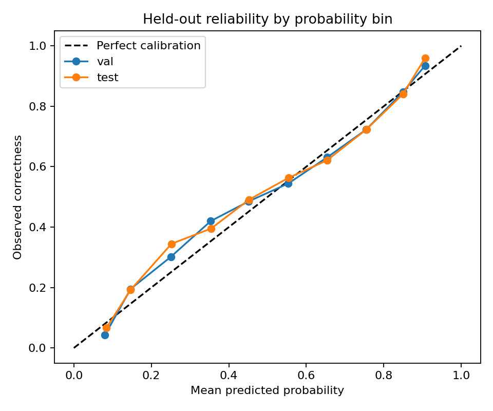

# Stage 4A-B — Simulator robustness and reward-dominance audit

**Notebook:** `SHIVA_LLM_Objective02_Stage4AB_Robustness_Audit_Colab.ipynb` · **Runtime:** Colab CPU · **Input:** Stage 4A ZIP · **Output archive:** `objective02_stage4ab_robustness_audit.zip`

## Purpose
Stress-tests the Stage 4A simulator before any policy is trained. No new model is fitted.

## 1. Held-out calibration
Test Brier is 0.1852, AUC 0.7420 and calibration-in-the-large +0.0032.

Learner-cluster bootstrap 95% intervals (`learner_bootstrap_ci.csv`):

| Split | Metric | 2.5% | Median | 97.5% |
|---|---|---|---|---|
| Test | AUC | 0.7237 | 0.7415 | 0.7641 |
| Test | Brier | 0.1778 | 0.1856 | 0.1924 |
| Test | Calibration-in-the-large | −0.0032 | 0.0033 | 0.0100 |

## 2. Readiness-stratified calibration (test)
| Readiness (p_observed) | n | Learners | Observed | Predicted | Gap |
|---|---|---|---|---|---|
| Low (< 0.4) | 4,665 | 259 | 0.286 | 0.237 | −0.050 |
| Middle (0.4–0.7) | 9,006 | 357 | 0.575 | 0.579 | +0.004 |
| High (> 0.7) | 18,851 | 372 | 0.799 | 0.815 | +0.016 |

The low-readiness group is **under-predicted by about 5 percentage points**. This limitation is carried through to Stages 6 and 7.

## 3. Action dominance (key finding)
`action_dominance.csv`: under the original reward, easy is optimal for **100% of contexts** in the small, moderate and large scenarios, and the per-context oracle equals fixed-easy. `reward_weight_sensitivity.csv` shows the same pattern across alternative weight and target-success grids.

**Decision:** the reward must be redesigned (Stage 4A-C), and only assumption-labelled one-step contextual-bandit claims are permitted (`audit_report.json`).

## Outputs
`audit_report.json`, `heldout_metrics.csv`, `learner_bootstrap_ci.csv`, `calibration_by_probability_bin.csv`, `readiness_calibration.csv`, `action_dominance.csv`, `reward_weight_sensitivity.csv`, `heldout_reliability.png`.
