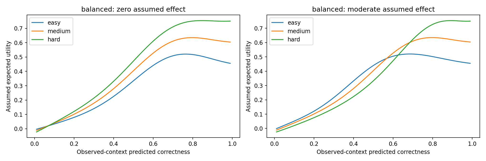

# Stage 4A-C — Reward and simulator redesign

**Notebook:** `SHIVA_LLM_Objective02_Stage4AC_Reward_Redesign_Colab.ipynb` · **Runtime:** Colab CPU, 12–16 GB RAM · **Inputs:** Stage 4A and 4A-B ZIPs · **Output archive:** `objective02_stage4ac_reward_redesign.zip`

## Purpose
Designs a reward under which the best action can depend on learner readiness. The design is chosen **on validation data only**, and the test split is used once as a locked audit.

## Redesigned utility
\[ U_a(p) = w_c\,q_a + w_m\,q_a\,c_a + w_s \exp\!\Big(-\tfrac{(q_a-\tau)^2}{2h^2}\Big) - w_k\,k_a \]
- \(q_a\) — assumed success probability under action \(a\) (as in Stage 4A).
- \(c_a\) — assumed challenge credit: easy 0.2, medium 0.6, hard 1.0.
- \(k_a\) — assumed effort cost: 0.15 / 0.35 / 0.60.
- Effect scenarios: zero (0.0, negative control), small 0.15, moderate 0.40, large 0.80.

## Candidate designs (pre-declared)
| Design | w_c | w_m | w_s | w_k | τ | h |
|---|---|---|---|---|---|---|
| original_like | 0.60 | 0.00 | 0.20 | 0.20 | 0.65 | 0.18 |
| **balanced (selected)** | **0.30** | **0.40** | **0.25** | **0.05** | **0.70** | **0.20** |
| mastery_focus | 0.20 | 0.55 | 0.20 | 0.05 | 0.75 | 0.20 |
| suitability | 0.15 | 0.20 | 0.60 | 0.05 | 0.70 | 0.14 |

## Locked test audit (balanced design)
| Scenario | Optimal easy / medium / hard | Best fixed | Oracle − best fixed |
|---|---|---|---|
| Zero | 0.0% / 0.5% / 99.5% | hard | 0.000004 |
| Small | 1.7% / 3.7% / 94.6% | hard | 0.00025 |
| **Moderate** | **25.7% / 13.9% / 60.4%** | hard | **0.0252** (95% CI 0.0225–0.0282) |
| Large | 28.2% / 31.7% / 40.0% | medium | 0.0588 |

At moderate effect, the oracle chooses **easy for all low-readiness learners, mixed easy/medium for medium readiness, and hard for all high-readiness learners** (`readiness_action_choices.csv`). This is a non-trivial, state-dependent decision problem.

`utility_curves.png` — expected utility of each action against predicted correctness. With zero assumed effect (left), hard dominates almost everywhere. With moderate effect (right), the curves cross, so the best action changes with readiness.

## Outputs
`stage4ac_report.json` (all assumptions and the selected design), `validation_sensitivity.csv`, `locked_test_sensitivity.csv`, `original_vs_redesigned.csv`, `readiness_action_choices.csv`, `learner_cluster_bootstrap.csv`, `utility_curves.png`.
