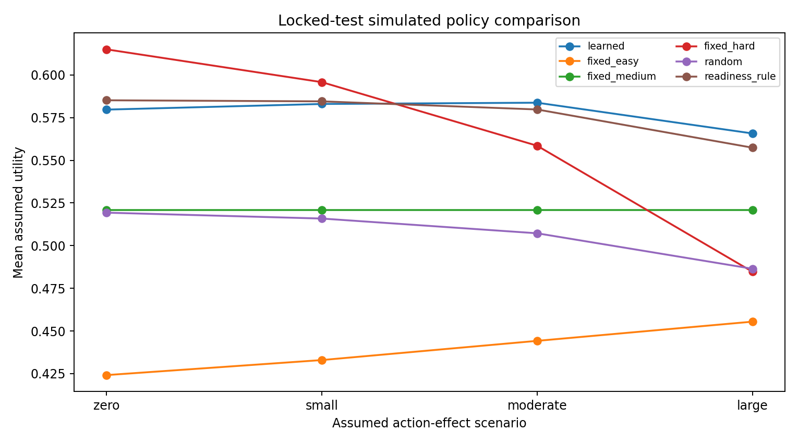

# Stage 4B — Simulation-based contextual-bandit policy optimisation

**Notebook:** `SHIVA_LLM_Objective02_Stage4B_Policy_Optimization_Colab.ipynb` · **Runtime:** Colab CPU · **Inputs:** Stage 4A and 4A-C ZIPs · **Output archive:** `objective02_stage4b_policy_optimization.zip`

## Purpose
Learns a policy mapping readiness to difficulty action under the **frozen** balanced reward. The policy is trained on training learners, selected on validation learners, and evaluated once on the locked test split.

## Training setup
- Context: `p_observed` (Stage 4A response-model prediction).
- Label: utility-maximising action under the **moderate** assumed effect on training contexts.
- Candidates: `DecisionTreeClassifier` with depth 2, 3, 5 and 8 (`min_samples_leaf=200`), and multinomial logistic regression.
- Selection criterion: mean simulated validation utility (`validation_model_selection.csv`). All trees tie at 0.573673 with zero regret, so the **simplest model, depth-2 tree**, is selected.
- Baselines: fixed easy / medium / hard, uniform random, and a **readiness rule** (easy if p < 0.4, medium if 0.4 ≤ p < 0.7, hard if p ≥ 0.7).

## Locked test results — moderate scenario (32,522 events, 402 learners)
| Policy | Mean simulated reward | Regret vs oracle | Easy / Medium / Hard |
|---|---|---|---|
| **Learned (tree depth 2)** | **0.583721** | ≈ 0 | 25.7% / 13.9% / 60.4% |
| Readiness rule | 0.579755 | 0.003965 | 14.3% / 27.7% / 58.0% |
| Fixed hard | 0.558514 | 0.025207 | 0 / 0 / 100% |
| Fixed medium | 0.520812 | 0.062908 | 0 / 100% / 0 |
| Random | 0.507227 | 0.076494 | 33.6% / 33.3% / 33.2% |
| Fixed easy | 0.444207 | 0.139513 | 100% / 0 / 0 |

Learned action by readiness (`learned_action_by_readiness.csv`): low → 100% easy; medium → 41% easy, 50% medium, 9% hard; high → 100% hard.

## Learned minus best fixed action (300 learner-cluster bootstrap reps)
| Scenario | Mean | 95% CI |
|---|---|---|
| Zero | −0.0354 | −0.0385 to −0.0321 |
| Small | −0.0128 | −0.0138 to −0.0118 |
| Moderate | +0.0253 | +0.0225 to +0.0282 |
| Large | +0.0449 | +0.0422 to +0.0484 |

The policy only beats the best fixed action when the assumed effect is moderate or large.

## Outputs
`stage4b_selected_policy.joblib` (frozen depth-2 tree), `stage4b_report.json`, `validation_model_selection.csv`, `validation_policy_comparison.csv`, `locked_test_policy_comparison.csv`, `learned_action_by_readiness.csv`, `learner_bootstrap_policy_comparison.csv`, `test_policy_rewards.png`.
