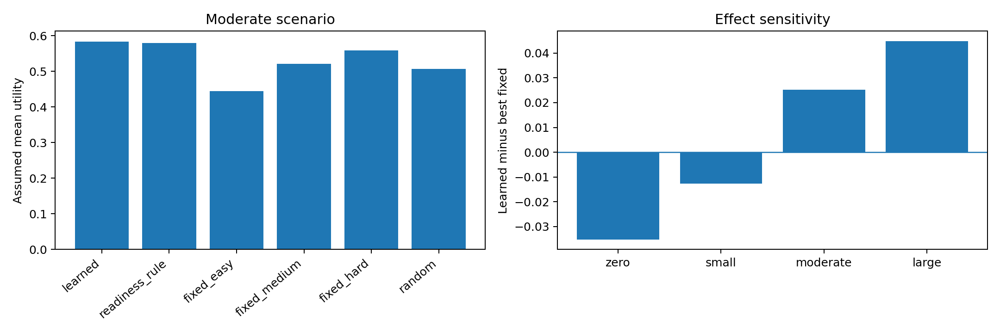

# Stage 5 — Comparative evaluation of the frozen policy

**Notebook:** `SHIVA_LLM_Objective02_Stage5_Comparative_Evaluation_Colab.ipynb` · **Runtime:** Colab CPU, 12–16 GB RAM · **Inputs:** Stage 4A, 4A-C, 4B ZIPs · **Output archive:** `objective02_stage5_comparative_evaluation.zip`

## Purpose
Gives a full statistical comparison of the frozen Stage 4B policy against all baselines on the locked test split. **Nothing is refitted or reselected.**

## 1. Replication check
The simulator and policies are rebuilt and Stage 4B rewards are reproduced exactly. The maximum absolute difference is **5.55 × 10⁻¹⁷** (`replication_audit.json`, `replication_policy_comparison.csv`).

## 2. Paired learner-cluster bootstrap (500 reps)
Learners are resampled with all their events, and every policy is scored on the same resample. The best fixed action is re-chosen inside each resample (`paired_learner_bootstrap.csv`).

| Scenario | Learned − readiness rule | Learned − random | Learned − best fixed |
|---|---|---|---|
| Zero | −0.0055 [−0.0063, −0.0047] | +0.0601 [+0.0536, +0.0669] | −0.0353 [−0.0385, −0.0324] |
| Small | −0.0015 [−0.0019, −0.0012] | +0.0671 [+0.0612, +0.0721] | −0.0128 [−0.0138, −0.0118] |
| **Moderate** | **+0.0040 [+0.0035, +0.0044]** | **+0.0764 [+0.0723, +0.0804]** | **+0.0253 [+0.0227, +0.0280]** |
| Large | +0.0084 [+0.0072, +0.0095] | +0.0793 [+0.0771, +0.0816] | +0.0450 [+0.0422, +0.0481] |

## 3. Robustness
- **Random baseline over 30 seeds** (`random_baseline_30_seeds.csv`): the moderate-scenario mean is 0.5078, close to the single-seed 0.5072.
- **Reward-weight robustness** (`reward_weight_robustness.csv`): weights are shifted towards correctness, challenge or suitability and renormalised, with the policy kept frozen. With more weight on challenge, the learned policy **falls slightly below the readiness rule** even at moderate effect (−0.0006).
- **Readiness-stratified results** (`readiness_stratified_comparison.csv`): at moderate effect the learned policy matches the readiness rule in the low group (0.1658, both choose easy) and gains in the medium group (0.5080 vs 0.4937).

## 4. Observational calibration by readiness
`observational_calibration_by_readiness.csv` reproduces the Stage 4A-B finding. The low-readiness group is predicted at 23.7% but observed at 28.6% correct.

Left panel: assumed mean utility per policy in the moderate scenario. Right panel: learned minus best fixed action for each assumed-effect scenario. The advantage is negative under zero and small effects.

## Outputs
`stage5_report.json`, `replication_audit.json`, `replication_policy_comparison.csv`, `paired_learner_bootstrap.csv`, `random_baseline_30_seeds.csv`, `reward_weight_robustness.csv`, `readiness_stratified_comparison.csv`, `observational_calibration_by_readiness.csv`, `stage5_policy_comparisons.png`.
