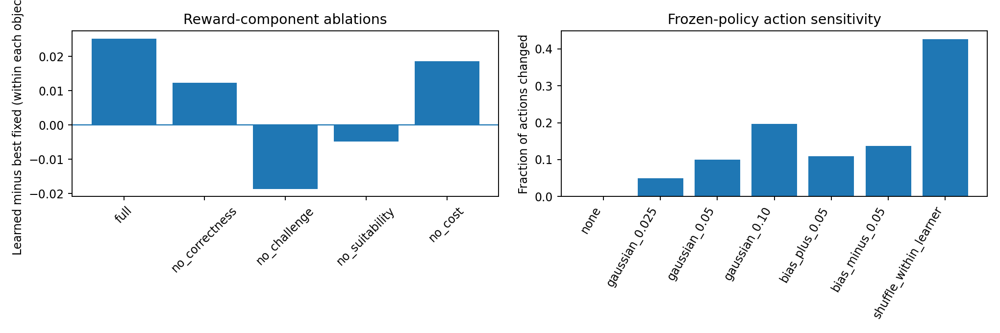

# Stage 6 — Ablations, stress tests and statistical analysis

**Notebook:** `SHIVA_LLM_Objective02_Stage6_Ablation_Analysis_Colab.ipynb` · **Runtime:** Colab CPU, 12–16 GB RAM · **Inputs:** Stage 4A, 4A-C, 4B, 5 ZIPs · **Output archive:** `objective02_stage6_ablation_analysis.zip`

## Purpose
Asks which assumptions the frozen policy's advantage depends on. All analyses are **post-hoc and exploratory**, and none is used to change the policy.

Stage 5 results are first reproduced exactly (maximum error 5.55 × 10⁻¹⁷, `stage5_replication_check.csv`).

## A. Leave-one-component-out reward ablation
Each reward weight in turn is set to zero and the rest are renormalised (`stage6_report.json` lists the exact weights). Because each ablation changes the objective, values are compared **within** an ablation, not across ablations.

| Ablation | Learned − readiness rule [95% CI, 500 reps] | Learned − best fixed |
|---|---|---|
| Full reward | +0.003965 [+0.003560, +0.004424] | +0.0252 |
| No correctness | +0.001820 [+0.001644, +0.002009] | +0.0124 |
| No challenge | +0.017075 [+0.015146, +0.019038] | −0.0187 |
| No suitability | **−0.003666 [−0.004088, −0.003264]** | −0.0049 |
| No cost | +0.003292 [+0.002955, +0.003624] | +0.0186 |

Removing the **suitability** term reverses the advantage over the readiness rule. Removing **challenge** makes the best fixed action superior.

## B. Readiness-input perturbation (10 seeds each)
The perturbed readiness is used to choose actions, and the actions are scored on the **original** context.

| Perturbation | Actions changed | Mean reward |
|---|---|---|
| None | 0% | 0.5837 |
| Gaussian σ = 0.025 | 4.9% | 0.5831 |
| Gaussian σ = 0.05 | 10.0% | 0.5814 |
| Gaussian σ = 0.10 | 19.7% | 0.5740 |
| Bias +0.05 | 10.9% | 0.5819 |
| Bias −0.05 | 13.8% | 0.5810 |
| Shuffle within learner | 42.7% | **0.5426** |

The policy tolerates small noise but clearly depends on correctly ordered readiness information.

## C. Readiness calibration
| Group | Events | Learners | Observed | Predicted | Gap | AUC |
|---|---|---|---|---|---|---|
| Low | 4,665 | 259 | 0.286 | 0.237 | −0.050 | 0.660 |
| Medium | 9,006 | 357 | 0.575 | 0.579 | +0.004 | 0.568 |
| High | 18,851 | 372 | 0.799 | 0.815 | +0.016 | 0.631 |

Left panel: learned minus best fixed action within each reward ablation. Right panel: fraction of actions that change under each readiness perturbation.

## Outputs
`stage6_report.json`, `stage5_replication_check.csv`, `reward_component_ablation.csv`, `paired_learner_ablation_ci.csv`, `readiness_perturbation_stress.csv`, `readiness_calibration.csv`, `stage6_ablation_figures.png`.
