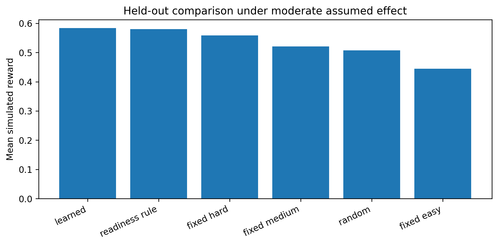
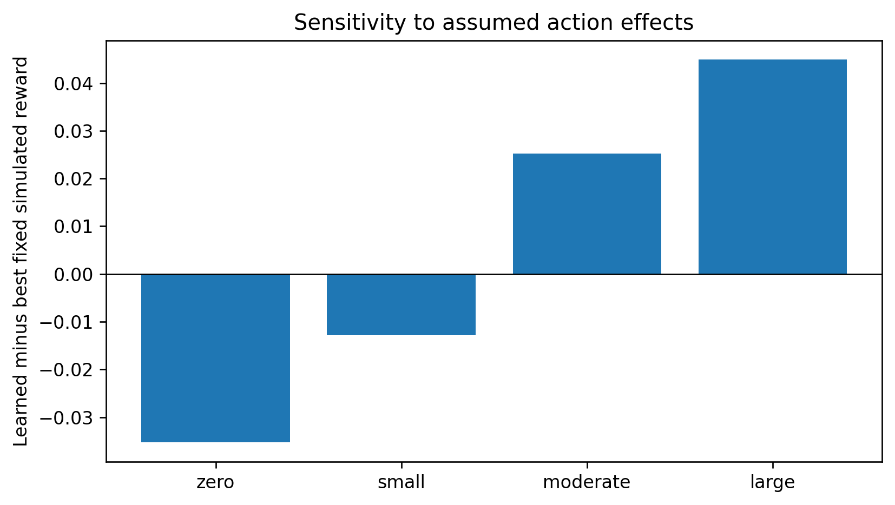
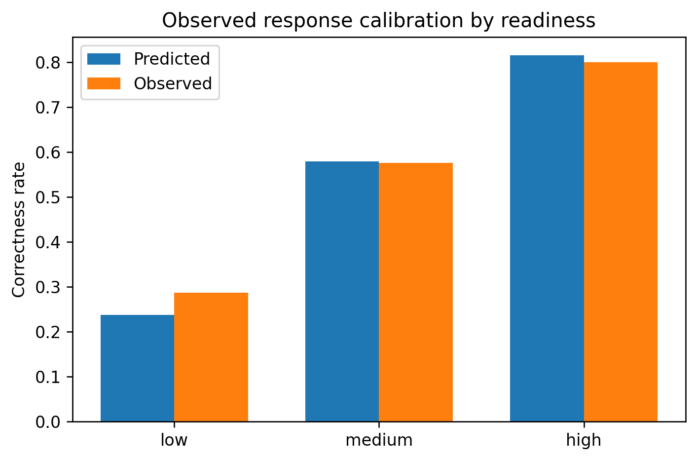

# Stage 7 — Publication and reproducibility package

**Notebook:** `SHIVA_LLM_Objective02_Stage7_Publication_Package_Colab.ipynb` · **Runtime:** Colab CPU · **Inputs:** Stage 4A, 4A-B, 4A-C, 4B, 5, 6 ZIPs · **Output archive:** `objective02_stage7_publication_package.zip`

## Purpose
Consolidates verified outputs into journal-ready tables, figures, a results draft and a provenance manifest. It **does not retrain or create new results**.

## Cross-stage audit (`outputs/reports/stage7_audit.json`)
Cross-stage integrity passed. The package covers 32,522 test events from 402 learners, with the depth-2 tree policy and balanced reward. The maximum Stage 5 vs Stage 6 difference is 5.55 × 10⁻¹⁷.

## Tables (`outputs/tables/`, each as CSV and LaTeX)
| # | Table | Source stage |
|---|---|---|
| 1 | Observational response-model metrics | 4A |
| 2 | Moderate-scenario policy comparison | 4B / 5 |
| 3 | Effect-size sensitivity (zero / small / moderate / large) | 4B / 5 |
| 4 | Learner-cluster bootstrap contrasts | 5 |
| 5 | Observational calibration by readiness | 5 |
| 6 | Reward-component ablation | 6 |
| 7 | Readiness-input perturbation | 6 |
| 8 | Reward-weight sensitivity | 5 |
| 9 | Stage 4A-C action sensitivity | 4A-C |

## Figures (`outputs/figures/`, PNG + vector PDF)
**Figure 1 — Simulated policy rewards (moderate effect)**

**Figure 2 — Sensitivity to the assumed action effect**

**Figure 3 — Readiness calibration (predicted vs observed correctness)**

`outputs/source_figures/` keeps the six original figures from Stages 4A, 4A-B, 4A-C, 4B, 5 and 6.

## Reports and provenance
- `reports/manuscript_results_and_limitations.md` — results and limitations draft generated from the tables.
- `provenance/manifest.json` — SHA-256 of every input ZIP, every member file and every output.
- `provenance/input_checksums.csv` — input ZIP checksums.
